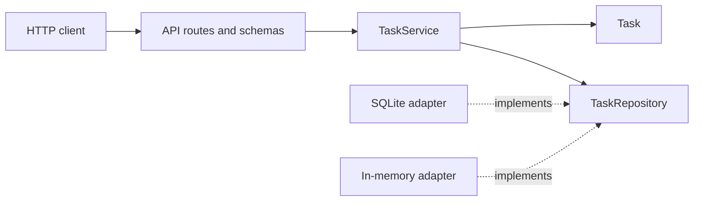

# Architecture

The service is a single process. A request crosses four layers, and each layer has one reason to change.

| Layer | Directory | May import | Changes when |
| --- | --- | --- | --- |
| Domain | `src/task_api/domain` | The standard library | A business rule changes |
| Application | `src/task_api/application` | Domain | A use case changes |
| Infrastructure | `src/task_api/infrastructure` | Domain | The database, config, or log format changes |
| API | `src/task_api/api` | Application and domain | The HTTP contract changes |

`src/task_api/main.py` builds the process. `src/task_api/api/dependencies.py` is the composition root: the one HTTP module allowed to construct the SQLite repository. Routes ask for a `TaskService` or a `TaskRepository` through FastAPI's `Depends`. They do not open sessions or write SQL.

`tests/unit/test_architecture.py` reads the source and fails if an inner layer imports an outer one. That test is a fitness function. It keeps the diagram true after the people who drew it have moved on.

## Request path

1. Middleware records the method, path, status, duration, and request id.
2. Pydantic validates the body and query against the HTTP schema.
3. The route turns a valid request into a `TaskDraft` or a `TaskPatch`.
4. `TaskService` loads a `Task`, calls a method on it, and asks the repository to store the result.
5. The route turns the `Task` into a response model.
6. The session dependency commits, or rolls the session back if the use case raised.

Validation exists in two places on purpose. The schema rejects malformed HTTP before a use case runs. The `Task` rejects a title that violates an invariant even when the caller is a test or a future worker that never touches HTTP. The duplicate is cheap. A missing domain check would let the next adapter persist a blank title.

## Domain

`Task` is a dataclass, not a row. It strips text, limits length, and treats priority and status as enums. Changing a value to the value it already has does not move `updated_at`. That makes "save" idempotent for clients that retry a patch.

The repository port lives next to the domain because the application needs a vocabulary for storage. The port has no SQLAlchemy types. Both `SqlAlchemyTaskRepository` and `InMemoryTaskRepository` satisfy it. The in-memory adapter returns copies, so a test fails if the service mutates an object and forgets to save it. The SQLite adapter returns new domain objects for the same reason.

`ping` is on the port so readiness can ask "can you answer?" without the route importing an engine. A larger system would split a `HealthProbe` port. This one has a single dependency, and a second port would only rename the same object.

## Persistence

Local development and the container use SQLite. Tests use either a temporary file or a shared in-memory database. `create_all` builds the schema. That is acceptable while the schema has no production history. The table also has `CHECK` constraints for priority, status, and text length, so a bug that bypasses the domain still cannot store an empty title.

Datetimes are stored through a custom type that reads them back as UTC. SQLite does not preserve timezone by itself.

Transactions are request-scoped. Repository methods flush so constraint failures surface inside the use case. The session dependency commits after a successful response.

## HTTP contract

Routes are thin. `POST /tasks` always creates an open task; completion is a later patch. `PATCH` uses the set of fields the client sent, so a missing field is different from an explicit `null`. Explicit null is rejected.

The list is a JSON array ordered by `created_at`, then `id`. There is no page object. Adding one later changes every client and requires a major version or a new path. See [ADR 0004](adr/0004-versioning-and-commits.md).

Errors are converted at the edge. Domain exceptions, request validation, HTTP exceptions, and unexpected exceptions all become `{error, message, details}`. Unexpected exceptions are logged with a traceback and answered with a fixed sentence.

## Configuration and logs

`Settings` reads `TASK_API_*` from the environment. Defaults are safe for a checkout with no `.env`. The startup log records the environment name, not the database URL, so a future URL with credentials is not copied into the log stream.

Application logs are JSON. The event name is the message (`task_created`, `request_completed`). Identifiers travel in `fields`.

## What this design refuses to hide

- There is no authentication. Anyone who can reach the port can change tasks.
- The list endpoint loads every matching row.
- `create_all` will not migrate data that already exists.
- The process is a single container. Readiness knows about SQLite and nothing else.

Those are recorded limits, not accidents. Promoting any of them into a feature starts with an ADR.
