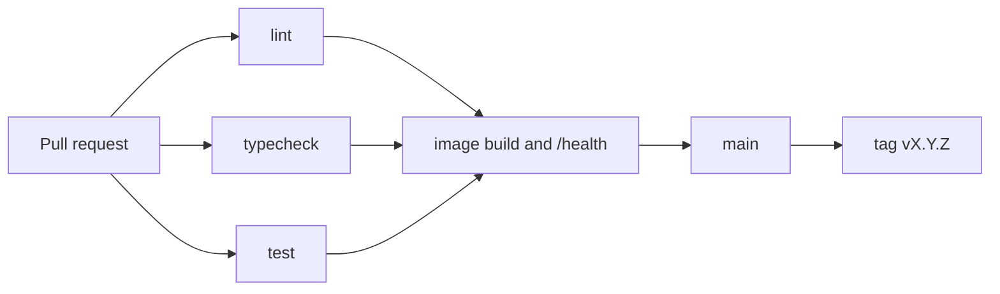

# Release process

This is the path from a change to a tagged version, and the path back if that version misbehaves.

## Branching

The long-lived branch is `main`. It is always releasable. Feature work happens on short-lived branches cut from `main`.

```text
main
  └── feat/filter-by-status
        └── pull request, CI green, review, squash merge
```

Rules:

- Branch names start with the commit type and a short description: `feat/task-filters`, `fix/ready-probe`, `docs/rollback-notes`.
- Do not commit directly to `main` once more than one person is pushing. Protect `main` so it requires the CI checks and one review.
- Rebase or merge `main` into the branch when it has drifted. Prefer rebase for a branch that has not been shared.
- Squash merge into `main`. The squash title must still be a Conventional Commit. The branch history is not the project history.
- Delete the branch after it merges.
- Release tags are cut from `main`, never from a feature branch.

This is trunk-based development with pull requests. The repository is too small for long-lived `develop` and `release` branches. Those branches hide integration until late.

## Commit messages

Follow [ADR 0004](adr/0004-versioning-and-commits.md). The summary is imperative. The body says why.

```text
fix: reject an explicit null title on update

Clients were sending null to mean "omit this field", and the task was stored with an empty title.
```

`COMMIT_MESSAGE.md` holds the message for the commit that creates this reference project. Later commits do not edit that file unless the class is discussing that specific commit.

## Pipeline



The workflow file is `.github/workflows/ci.yml`.

| Job | Command | Fails when |
| --- | --- | --- |
| lint | `ruff check` and `ruff format --check` | Style or import order drifts |
| typecheck | `mypy src tests` | A strict-mode type error appears |
| test | `pytest` | A unit or integration test fails |
| build | `docker build`, then `GET /health` | The image does not build or the process does not serve |

The build job needs the other three, so a broken test does not spend time on an image. A green pipeline is necessary for merge. It is not sufficient. Review still has to read the change.

There is no separate deploy job. This reference project stops at a tagged image. A host that runs the image is an operations choice recorded in a future ADR.

## Semantic versioning

`pyproject.toml` and `task_api.__version__` move together.

| Change | Bump | Example |
| --- | --- | --- |
| Contract break | MAJOR | Task list becomes an object, a field disappears, an error code changes |
| Compatible addition | MINOR | A new optional query parameter |
| Contract-preserving fix | PATCH | Readiness used the wrong status code |

While the version is `0.y.z`, a minor bump may still change the contract if the changelog says so in a sentence a caller can find. After `1.0.0`, contract breaks are major only.

Image tags:

- `task-api:0.1.0` for the release a human asked for.
- `task-api:<git-sha>` for the image CI built from a commit.

Do not retag `0.1.0` onto a different commit. Build a new patch instead.

## Release checklist

1. `main` is green on the commit you intend to tag.
2. The changelog has a section for the version, with today's date, and the entries match the commits a caller would notice.
3. `pyproject.toml` and `src/task_api/__init__.py` carry that version.
4. `make check` passes on a clean checkout.
5. `make build` produces an image, and `make smoke` receives `{"status":"ok"}` from `/health`.
6. The tag is annotated and matches the changelog: `git tag -a v0.1.0 -m "Task API 0.1.0"`.
7. The tag and `main` are pushed. The image is tagged `task-api:0.1.0` from the same commit.
8. The release notes quote the changelog. They do not invent behavior the tests do not cover.

## Rollback

Rollback is redeploying the previous image tag. It is not a downward commit on `main` unless the previous image cannot be started.

Before a release, name the rollback:

- Previous image tag, for example `task-api:0.1.0` when releasing `0.2.0`.
- Whether the schema changed. `create_all` does not migrate. A release that changes columns can leave an old image unable to read a new file. Those releases need a restore of the SQLite file from the backup taken before deploy, or they are not rollback-safe.
- Whether the HTTP contract changed. Clients built for the new contract may fail against the old one. That is acceptable. Data loss is not.

Operator steps when the new tag misbehaves:

1. Stop sending traffic. `/ready` returning `503`, or `/health` failing the container check, is the signal.
2. Start the previous image tag with the same `/data` volume, unless step 3 says the file is incompatible.
3. If the release changed the schema, restore the SQLite file taken immediately before the deploy, then start the previous image.
4. Confirm `GET /health` and `GET /ready`, then one known task read.
5. Write the incident in the changelog as a yanked version if the tag must not be reused, and ship the correction as the next patch.

Do not force-push `main` to erase a bad release. The tag and the fix are the record.

Database backup, for the single file this project uses:

```bash
sqlite3 /data/tasks.db ".backup /data/tasks-before-release.db"
```

Take that backup before a deploy that is not a pure image rebuild of the same schema.

## Code review checklist

Review the pull request against the behavior, not against a style preference Ruff already enforces.

- The story's acceptance criteria are met, and a test fails if the behavior is removed.
- Domain rules live in `Task`, not only in a Pydantic validator.
- A new failure uses `{error, message, details}` and a status code from the requirements.
- The change sits in the right layer. Routes do not import SQLAlchemy. The service does not import FastAPI.
- Tests use the in-memory port, SQLite, or HTTP for the reason described in the testing strategy. They do not sleep to get a timestamp.
- Configuration comes from `TASK_API_*`. No secret, token, or database file is in the diff.
- Logs add an event and identifiers. They do not record the request body.
- The changelog and version move when the caller-visible behavior moves.
- The author named the rollback: previous tag, and whether the schema or the contract changed.
- The diff is one story. Drive-by refactors are a separate pull request.

The pull request template repeats the items a merge requires. If the template and this list disagree, this list is the one to update first, and the template follows in the same change.
