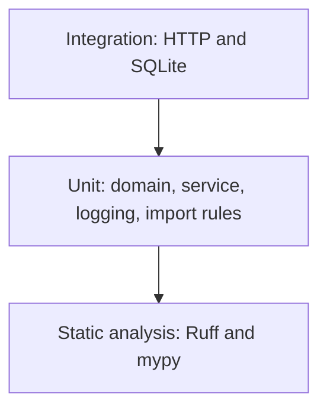

# Testing strategy

Tests answer a specific question at the cheapest layer that can answer it. A failure should point at the rule that broke, not at the whole process.

## Pyramid



Static analysis is the wide base even though it is not a pyramid layer in the classic drawing. It runs first because it is fast and it catches layer and type mistakes before a test boots the app.

| Layer | Location | Question it answers | What it does not do |
| --- | --- | --- | --- |
| Unit | `tests/unit` | Does the rule or use case behave? | Open a socket or a SQL file |
| Integration | `tests/integration` | Does the adapter and the HTTP contract hold? | Replace the unit tests of the rules |
| Image smoke | `make smoke` and CI `build` | Does the built image answer `/health`? | Cover the task endpoints |

There is no browser end-to-end suite. This service has no browser UI. The HTTP integration tests are the top of the pyramid.

## What each suite owns

**Domain** (`tests/unit/test_domain.py`). Title and description limits, whitespace, enum membership, and the rule that an unchanged value does not move `updated_at`. These tests construct a `Task` and nothing else.

**Application** (`tests/unit/test_task_service.py`). Create, filter, patch, and delete against `InMemoryTaskRepository`. A clock returns increasing timestamps so order and `updated_at` do not depend on the system clock. The repository is checked against the `TaskRepository` protocol, so a signature drift fails mypy and this test's construction.

**Architecture** (`tests/unit/test_architecture.py`). An AST walk over `src/task_api`. Domain and application may not import outer layers or frameworks. API modules other than `dependencies.py` may not import infrastructure or SQLAlchemy. This is a fitness function, not a behavior test.

**Logging and configuration** (`tests/unit/test_config_and_logging.py`). The formatter emits one JSON object and escapes newlines. Settings read `TASK_API_*` and ignore unknown names.

**Error envelope** (`tests/unit/test_errors.py`). Field paths lose the `body` and `query` prefix. The body always has `error`, `message`, and `details`.

**Persistence** (`tests/integration/test_persistence.py`). The SQLite adapter is opened, committed, and read again in a second session. A second session matters: a test that only reads the identity map can pass while nothing was written. The suite also checks filters, delete, duplicate ids, the `CHECK` constraint, and UTC round-trip.

**HTTP** (`tests/integration/test_api.py`). One temporary SQLite file per test, created in the fixture and discarded with `tmp_path`. The suite covers the lifecycle, filters, validation, unknown routes, the readiness failure override, request ids, and the rule that an unexpected exception does not leak its text.

## Deterministic databases

- Adapter tests use `sqlite://` with a `StaticPool`, so every session shares one in-memory database. Without the shared pool, SQLite memory databases are per-connection and `create_all` appears to do nothing.
- API tests use a file under `tmp_path`. That matches the file URL the application uses in development, including commit behavior across connections.
- Tests clear `TASK_API_*` from the environment before they construct settings. They do not read a developer's `data/tasks.db`.
- Each test builds its own `FastAPI` app. Dependency overrides cannot leak into the next test.

## What we do not mock

The HTTP tests do not mock the repository. They mock only the readiness probe, because "the database is down" is hard to force through a healthy SQLite file without deleting the process. The service tests do not mock the domain. They use a second real adapter.

A mock that only records calls would pass if the service called `save` with a blank title. The in-memory adapter still enforces `Task` construction, so the invalid object never gets that far.

## Static analysis

- Ruff checks style, import order, and a small set of bug risks. `ruff format --check` fails on drift.
- mypy runs in strict mode on `src` and `tests`. A new untyped helper fails the build.
- pytest uses `--strict-markers` so a typo in a marker is a failure.

## CI

GitHub Actions runs four jobs: `lint`, `typecheck`, `test`, and `build`. The image build waits for the other three. It then starts the container and requests `GET /health`. A pipeline that only builds an image can ship a process that never binds the port.

Local equivalents:

```bash
make check
make build
make smoke
```

## When to add a test

- A new domain rule gets a unit test that does not import FastAPI.
- A new use case gets a service test on the in-memory adapter.
- A new SQL behavior gets a two-session persistence test.
- A new status code or error code gets an HTTP test that asserts the envelope keys.
- A new import that reaches across layers should fail `test_architecture.py` without any new assertion, or the test is wrong and must be fixed in the same pull request.

## Coverage

There is no coverage percentage gate. A gate that is not read becomes a number people game with assertions-free tests. The traceability table in [requirements.md](requirements.md) names which tests lock which story. Reviewers use that table. A story with no named test is not done.
